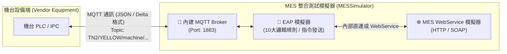
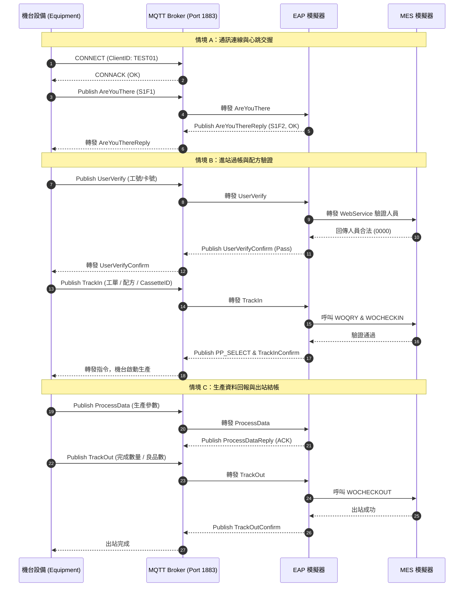

# 乾坤科技 (Cyntec) MES 模擬器與 EAP 整合測試操作說明書

> **文件版本**：v1.0  
> **適用對象**：機台設備製造商、自動化軟硬體協力廠商、系統整合工程師  
> **編寫目的**：提供廠商於廠外開發、出廠前預先驗證（FAT）以及廠內現場上線連線測試時，使用 MES 模擬器驗證通訊協定、進出站邏輯、配方核對與異常處理之操作準則。

---

## 1. 系統概述與架構 (System Overview & Architecture)

MES 模擬器為一全功能整合測試工具，內建三大核心模組：
1. **MES WebService 模擬器**：模擬工廠 MES 核心 SOAP/HTTP WebService 服務，提供工單查詢、人員驗證、進站 (TrackIn)、出站 (TrackOut) 及剩料等業務邏輯模擬。
2. **內建 MQTT Broker 監控**：提供單機內嵌式 MQTT Broker 服務（預設埠號 `1883`），無需額外安裝第三方 Broker 即可監控所有連線 Client 與通訊訊息流量。
3. **EAP 模擬器 (設備商測試專用)**：模擬工廠端 EAP (Equipment Automation Program) 主控系統，透過 MQTT 協定與機台進行雙向溝通，支援 10 大自動回應業務規則、主動控制命令下發與螢幕訊息發送。

### 1.1 系統整合通訊架構圖



---

## 2. 執行環境需求與啟動 (Prerequisites & Getting Started)

### 2.1 系統需求
* **作業系統**：Windows 10 / 11 或 Windows Server 2016 以上（64 位元架構）。
* **執行階段**：.NET 8 Runtime (Windows Desktop Runtime)。
* **通訊埠需求**：
  * **Port 1883**（TCP）：供 MQTT Broker 使用（若本機有安裝 Mosquitto 請先暫停，避免通訊埠衝突）。
  * **Port 5000** 或指定 WebService 埠（HTTP）：供 MES WebService 服務監聽。

### 2.2 程式啟動
1. 執行 `MESSimulator.exe`。
2. 啟動後系統主介面包含三大頁籤：
   * **🌐 MES WebService 模擬器**：預設為啟動監聽狀態。
   * **📡 內建 MQTT Broker 監控**：預設自動於 Port `1883` 啟動監聽。
   * **🤖 EAP 模擬器 (設備商測試專用)**：預設為**停止**狀態，點擊「啟動 EAP」後開始連線與自動應答。

---

## 3. 功能模組詳細操作指南 (Module Instructions)

### 3.1 頁籤一：🌐 MES WebService 模擬器

本模組模擬標準 MES 伺服器，接收機台或 EAP 發送的 SOAP XML 封包（內含 JSON 參數），並自動回傳模擬的成功或失敗結果。

```
+-----------------------------------------------------------------------------------+
| 監聽 IP: [ * (全部網卡) v ]  Port: [ 8070 ]  [Start] [Stop]       [💾 輸出 MES Log]|
| 模擬開關: [v] UserVerify  [v] WOQRY  [v] WOCHECKIN  [v] WOCHECKOUT  [v] EQPSTATUS |
| 進階模擬: 投入數(QTY): [ 1000 ]  [ ] 工單Recipe不一致  [ ] 模擬ERROR0049(站點不合) |
+---------------------------------------------------------+-------------------------+
| [即時 SOAP Request 封包檢視區]                          | [即時互動日誌清單]      |
| 顯示接收到的原始 SOAP XML 與 TransactionName            | 顯示 [RECV] / [SEND]    |
+---------------------------------------------------------+-------------------------+
```

#### 核心操作說明：
1. **服務監聽 IP 與 Port 設定**：
   * **監聽 IP**：下拉選單會自動偵測並列出本機所有區網 IPv4 位址，並提供 `* (全部網卡)`、`localhost`、`127.0.0.1`。
     * **單機測試**：選擇 `localhost` 或 `127.0.0.1` 即可。
     * **跨電腦連線（外部系統直接呼叫 MES WebService）**：請對 `MESSimulator.exe` 按右鍵選擇「**以系統管理員身分執行**」，並選擇 `* (全部網卡)` 或指定本機區網 IP（如 `192.168.1.100`），預設連接埠為 `8070`。
2. **交易通過/拒絕模擬（防呆開關）**：
   * **人員驗證 (USERVERIFY)**：勾選代表刷卡驗證成功，取消勾選則模擬無效人員拒絕進站。
   * **工單查詢 (WOQRY)**：勾選代表工單合法；取消勾選則回傳查詢失敗。
   * **進站確認 (WOCHECKIN)** / **出站確認 (WOCHECKOUT)**：控制進出站過帳回傳成功或失敗。
3. **進階防呆場景模擬**：
   * **自訂 WIP 數量 (WIPQty)**：可自由指定在製品數量，測試機台讀取數量與分割批次邏輯。
   * **模擬配方不符 (Recipe Mismatch)**：勾選後，工單查詢將故意回傳與機台當前配方不符的 `RecipeID`，驗證機台是否具備防呆停機並發出警報之機制。
   * **模擬 ERROR0049**：模擬「此工單不屬於此站點可進站之工單」，驗證機台攔截提示邏輯。
4. **即時封包監控與匯出**：
   * 左側面板即時顯示完整的 SOAP XML 請求封包。
   * 右側面板即時呈現解析後之 JSON 內容與回傳結果。
   * 點擊「💾 輸出 MES Log」可將所有 MES 通訊日誌保存為文字檔（.log）。

---

### 3.2 頁籤二：📡 內建 MQTT Broker 監控

本模組內嵌高效能 MQTT 伺服器，方便設備廠商在無外網與專用伺服器環境下，進行單機或跨區網的端對端測試。

#### 核心操作說明：
1. **監聽 IP 與 Port 設定**：
   * **監聽 IP**：預設為 `0.0.0.0 (全部網卡)`，啟動後會在下方日誌自動印出本機所有可連線之區網 IP（例如：`本機可連線 IP: 192.168.1.100`）；亦可從下拉選單指定綁定單一網卡 IP。
   * **Port**：預設監聽連接埠為 `1883`。
   * **廠商機台連線方式**：
     * 若機台程式與模擬器在**同一台電腦**，機台端 MQTT 連線 IP 請設為 `127.0.0.1:1883`。
     * 若機台與模擬器在**不同電腦（透過網路線/交換器連接）**，機台端 MQTT 連線 IP 請設為模擬器日誌中顯示的**本機區網 IP**（如 `192.168.1.100:1883`）。
2. **已連線用戶端監控 (Connected Clients)**：
   * 表格即時列出目前連線至 Broker 的 Client ID、IP 端點位址與連線時間。
   * 廠商可透過此清單快速確認機台網路設定是否正確連上。
3. **即時 Topic 與訊息流量監控 (Traffic Monitor)**：
   * 監聽所有連線與訂閱事件，即時顯示 Client 連線、斷線與訂閱之 Topic 清單。

---

### 3.3 頁籤三：🤖 EAP 模擬器（設備商測試專用）

本模組是機台設備廠商最關鍵的測試介面，完全模擬乾坤工廠端 EAP 系統的自動控制與反應行為。

```
+----------------------------------------------------------------------------------------------------+
| 狀態: ● EAP Sim Stopped  Broker IP: [ 127.0.0.1 v ] Port: [ 1883 ] [啟動 EAP] [停止 EAP]           |
| 規則批量設定: [ ☑ 全選自動回復 ] [ ☐ 全部取消自動回復 ] [ 重設全部為 PASS ]      [💾 輸出 EAP Log] |
+----------------------------------------------------------------------------------------------------+
| 目標 Cmd Topic (TEST01): [ TN2/YELLOW/machine/TEST01/Command ] [AreYouThere] [StatusReq] [TimeCal] |
| Trace週期: [ 5 ] Enable: [ true ] [發送 InitTraceData]                                             |
| 遠端控制: [PP_SELECT    v] PP_SELECT RecipeID: [ 11 ] [發送 RemoteCMD] [💬 發送 TerminalDisplay...]|
+----------------------------------------------------------------------------------------------------+
| [10 大業務邏輯規則設定清單 (DataGridView)]                                                         |
| 自動回覆 | 強制失敗 | 邏輯名稱 | 設備上報指令(Trigger) | EAP回覆指令(Reply) | 動作與檢查說明       |
+----------------------------------------------------------------------------------------------------+
| [EAP 即時執行與通訊日誌]                                                                           |
+----------------------------------------------------------------------------------------------------+
```

#### 1. 連線 Broker IP、目標設備與主題規則
* **Broker IP 與 Port**：
  * 若使用本程式頁籤二的「內建 MQTT Broker」，維持預設 `127.0.0.1` 與 Port `1883` 即可（即使廠商機台從外部電腦連入內建 Broker，EAP 模擬器在同機透過 `127.0.0.1` 即可與機台雙向互通）。
  * 若廠商環境已有架設外部獨立的 MQTT Broker，可直接在 `Broker IP` 欄位輸入外部 Broker 的 IP 位址與 Port，再點擊「啟動 EAP」。
* **預設設備代號**：`TEST01`（符合乾坤 Delta / SECS-GEM 標準機台識別碼）。
* **標準發送主題 (Command Topic)**：`TN2/YELLOW/machine/TEST01/Command`
* **標準監聽主題 (Report Topic)**：`TN2/YELLOW/machine/TEST01/Report`

#### 2. 十大自動應答規則清單 (Logic Rules)

| 編號 | 規則代碼 (RuleKey) | 觸發指令 (Trigger) | 回覆指令 (Reply) | 說明與測試用途 |
| :---: | :--- | :--- | :--- | :--- |
| **1** | `RULE_ARE_YOU_THERE` | `AreYouThere` (S1F1) | `AreYouThereReply` (S1F2) | 連線握手驗證。機台開機或重新連線時確認 EAP 是否在線。 |
| **2** | `RULE_STATUS_CHANGE` | `StatusChange` (S1F3) | `StatusChangeReply` (S1F4) | 機台狀態變更（例如：IDLE、RUN、DOWN）時的確認。 |
| **3** | `RULE_ALARM_REPORT` | `AlarmReport` (S5F1) | `AlarmReportReply` (S5F2) | 機台發生異常或警報解除時的通知確認。 |
| **4** | `RULE_TRACK_IN_PP_SELECT` | `PPSelectConfirm` | `PPSelect` (S7F1) | 進料時檢查並確認配方選擇指令。 |
| **5** | `RULE_TRACK_IN_FINAL` | `TrackIn` (S2F41) | `TrackInConfirm` | 檢查料捲/工單進站合規性並完成過帳。 |
| **6** | `RULE_TRACK_OUT` | `TrackOut` (S2F41) | `TrackOutConfirm` | 完成批次出站結帳確認。 |
| **7** | `RULE_PROCESS_DATA` | `ProcessData` (S6F11)| `ProcessDataReply` (S6F12)| 機台生產結束後上報製程數據/參數資料。 |
| **8** | `RULE_TRACE_DATA` | `TraceData` (S6F1) | `TraceDataReply` (S6F2) | 機台週期性取樣數據（如溫度、壓力）上報確認。 |
| **9** | `RULE_EVENT_USER_VERIFY` | `UserVerify` | `UserVerifyConfirm` | 操作員刷卡權限確認。 |
| **10** | `RULE_EVENT_DEFAULT` | `EventReport` (S6F11)| `EventReportReply` (S6F12)| 通用設備事件上報確認。 |

#### 3. 測試控制機制
* **自動應答 (AutoReply)**：勾選時，EAP 模擬器收到機台訊息後會在數毫秒內自動回覆應答封包；取消勾選則不回覆，用以測試**機台超時 (Timeout) 與斷線重試機制**。
* **強制失敗 (ForceFail)**：勾選時，EAP 模擬器會故意回傳失敗代碼（如 `ResultCode != 0` 或 `ACK != 0`），用以驗證**機台遇到 EAP 拒絕時之防呆停止作業流程**。

#### 4. 主動控制指令發送功能
* **發送 InitTraceData**：設定取樣週期（毫秒）與參數清單，通知機台啟動即時數據取樣追蹤。
* **發送 RemoteCMD**：
  * 下拉選單提供：`PP_SELECT`（指定配方）、`START`（啟動機台）、`STOP`（停止機台）、`PAUSE`（暫停機台）、`RESUME`（恢復運作）。
  * 選擇 `PP_SELECT` 時可在右側文字框輸入指定之配方名稱。
* **💬 發送 TerminalDisplay...**：
  * 點擊後彈出輸入對話框，可輸入多行文字訊息發送至機台螢幕，測試機台端介面文字顯示能力。

---

## 4. 設備廠商標準整合驗證流程 (Vendor Integration SOP)

設備廠商在出廠檢驗或驗收前，請務必依序完成以下 4 項情境測試：



### 4.1 情境 A：通訊連線與心跳交握
1. 確認 `MESSimulator` 之 MQTT Broker 與 EAP 模擬器皆已啟動。
2. 機台連線至 `localhost:1883`（若機台位於獨立電腦，請輸入執行模擬器之主機 IP）。
3. 機台發送 `AreYouThere` 至 `TN2/YELLOW/machine/TEST01/upload/req`。
4. 驗證機台是否於 1 秒內收到 `AreYouThereReply` 且狀態為成功。

### 4.2 情境 B：進站過帳與配方驗證
1. 機台操作員刷卡，機台發送 `UserVerify`。
2. 檢查 EAP 模擬器是否回覆 `UserVerifyConfirm`。
3. 機台發送 `TrackIn` 請求（包含工單號碼與當前設定之配方名稱）。
4. 觀察 EAP 模擬器：
   * **正常情況**：EAP 自動呼叫 MES 驗證，下發 `PP_SELECT` 並回傳 `TrackInConfirm`，機台進入可生產狀態。
   * **異常防呆測試**：勾選 MES 的「模擬配方不符」或「模擬 ERROR0049」，再發送 `TrackIn`，驗證機台是否正確鎖機報警。

### 4.3 情境 C：生產資料回報與出站結帳
1. 機台加工完成，收集加工參數（如溫度、壓力、生產週期時間等）發送 `ProcessData`。
2. 確認 EAP 回應 `ProcessDataReply`。
3. 機台發送 `TrackOut` 請求，附帶完成良品數量。
4. EAP 自動向 MES 進行過帳結帳，回覆 `TrackOutConfirm`，機台復歸至待機狀態。

### 4.4 情境 D：異常處理與斷線重試測試
1. **警報回報測試**：機台人為觸發任一警報代碼，發送 `AlarmReport`，驗證 EAP 是否能正確收到並應答。
2. **通訊逾時測試**：在 EAP 模擬器中，將對應規則之「自動應答 (AutoReply)」取消勾選，發送指令後觀察機台逾時防呆處理（應有重試與逾時警報機制，嚴禁機台程式當機）。
3. **強制失敗測試**：將規則之「強制失敗 (ForceFail)」勾選，驗證機台接收到失敗代碼時的錯誤處理邏輯。

---

## 5. 通訊協定與封包範例 (Message Payloads & Examples)

### 5.1 MQTT 主題定義規範

| 方向 | 主題 (Topic) 格式 | 說明 |
| :--- | :--- | :--- |
| **機台上報至 EAP** | `TN2/YELLOW/machine/{EqpId}/upload/req` | 機台狀態、警報、過帳請求、資料收集 |
| **EAP 回應給機台** | `TN2/YELLOW/machine/{EqpId}/upload/reply` | EAP 對機台上報之應答 (Reply / ACK) |
| **EAP 主動下發機台**| `TN2/YELLOW/machine/{EqpId}/command/req` | EAP 遠端控制 (RemoteCMD)、螢幕訊息 |
| **機台回應給 EAP** | `TN2/YELLOW/machine/{EqpId}/command/reply`| 機台執行遠端指令後之回覆確認 |

> 註：整合測試時 `{EqpId}` 預設請填寫 `TEST01`。

### 5.2 常用封包範例

#### 範例 1：AreYouThere (S1F1 連線交握)
* **機台發送 (Upload Req)**：
```json
{
  "TransactionName": "AreYouThere",
  "TransactionID": "TXN_20261022_001",
  "EquipmentID": "TEST01",
  "Timestamp": "2026-10-22T10:00:00.000"
}
```
* **EAP 回覆 (Upload Reply)**：
```json
{
  "TransactionName": "AreYouThereReply",
  "TransactionID": "TXN_20261022_001",
  "EquipmentID": "TEST01",
  "Result": "success",
  "ResultCode": "0",
  "Message": "EAP Online"
}
```

#### 範例 2：TrackIn (進站請求)
* **機台發送 (Upload Req)**：
```json
{
  "TransactionName": "TrackIn",
  "TransactionID": "TXN_20261022_002",
  "EquipmentID": "TEST01",
  "WorkOrder": ["WO20261022001"],
  "RecipeID": "RECIPE_A01",
  "UserID": "123456",
  "CassetteID": ["CST001"]
}
```
* **EAP 回覆 (Upload Reply)**：
```json
{
  "TransactionName": "TrackInConfirm",
  "TransactionID": "TXN_20261022_002",
  "EquipmentID": "TEST01",
  "Result": "success",
  "ResultCode": "0",
  "Message": "Track In Successful"
}
```

#### 範例 3：RemoteCMD - PP_SELECT (遠端切換配方)
* **EAP 發送 (Command Req)**：
```json
{
  "TransactionName": "RemoteCMD",
  "TransactionID": "CMD_20261022_001",
  "EquipmentID": "TEST01",
  "Command": "PP_SELECT",
  "Parameters": {
    "RecipeID": "RECIPE_A01"
  }
}
```
* **機台回覆 (Command Reply)**：
```json
{
  "TransactionName": "RemoteCMDReply",
  "TransactionID": "CMD_20261022_001",
  "EquipmentID": "TEST01",
  "Command": "PP_SELECT",
  "Result": "success",
  "ResultCode": "0"
}
```

---

## 6. 常見問題與故障排查 (Troubleshooting & FAQ)

### Q1：啟動 MQTT Broker 時跳出「連接埠已被使用 (Address already in use)」錯誤？
* **原因**：本機已安裝其他 MQTT Broker（如 Mosquitto、EMQX）或前次模擬器未正常釋放 Port 1883。
* **排查步驟**：
  1. 開啟工作管理員或以命令提示字元輸入 `netstat -ano | findstr 1883` 查詢佔用該連接埠的 PID。
  2. 若為 Windows 服務中的 Mosquitto，請於「服務」管理員中先暫停 Mosquitto Broker 服務。

### Q2：機台發送訊息後，EAP 模擬器完全沒有反應？
* **檢查清單**：
  1. 請至「🤖 EAP 模擬器」頁籤確認狀態是否為「**已啟動**」（預設為停止，需手動點擊「▶ 啟動 EAP」）。
  2. 請檢查發送之 MQTT Topic 是否完全吻合（注意英文字母大小寫，預設應為 `TN2/YELLOW/machine/TEST01/upload/req`）。
  3. 請至「📡 內建 MQTT Broker 監控」頁籤確認該機台是否出現在「已連線用戶端」清單中。
  4. 確認 JSON 封包格式是否符合標準，若欄位名稱或型態不合法可能無法解析。

### Q3：機台發送請求後，EAP 回傳失敗 (FAIL)？
* **排查步驟**：
  1. 檢查對應之規則是否勾選了「**強制失敗 (ForceFail)**」。
  2. 檢查 MES WebService 模擬器頁籤中，是否有自訂錯誤代碼或開啟了配方不符模擬。
  3. 檢視 EAP 模擬器右下角之「即時執行與通訊日誌」視窗，查看失敗原因的具體詳細錯誤訊息。

### Q4：測試完成後，如何提供測試佐證記錄？
* 在「MES WebService 模擬器」頁籤點擊「**匯出日誌**」。
* 在「EAP 模擬器」頁籤點擊「**匯出 EAP 日誌**」。
* 兩個日誌檔案可直接打包提供給乾坤系統工程師檢視審查。
