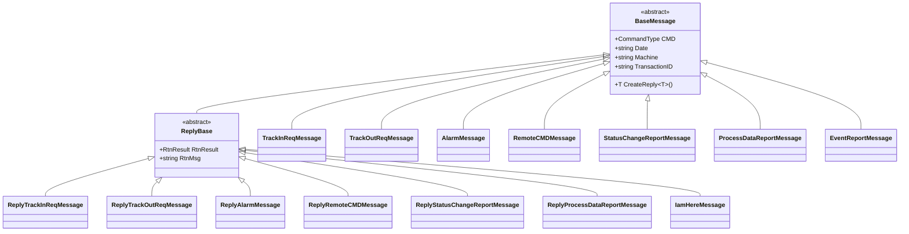
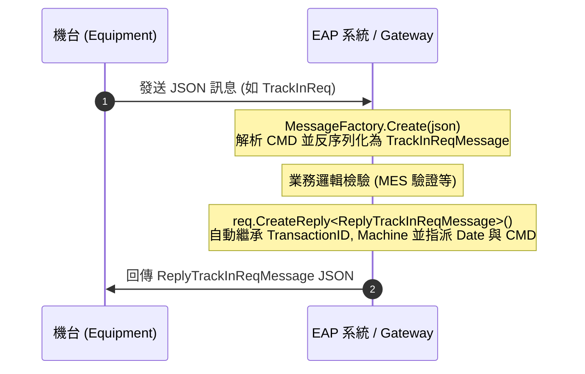

# 📘 Protocol.Core.dll 架構規格與開發使用指南

本文件針對 `dll\Protocol.Core.dll\Protocol.Core.dll`（版本 `2.0.0.0`）進行完整結構分析與使用說明。本程式庫為 Cyntec 設備自動化（EAP / Edge Gateway）與機台（EQ）之間通訊通用的核心資料契約（Data Contracts）、訊息多型工廠（Message Factory）與序列化工具庫。

---

## 📑 目錄

1. [模組簡介與基本資訊](#1-模組簡介與基本資訊)
2. [系統架構與設計理念](#2-系統架構與設計理念)
3. [基礎架構層 (`Protocol.Core.Base`)](#3-基礎架構層-protocolcorebase)
   - [3.1 `BaseMessage` 基礎訊息抽象類別](#31-basemessage-基礎訊息抽象類別)
   - [3.2 `ReplyBase` 回應訊息抽象類別](#32-replybase-回應訊息抽象類別)
   - [3.3 `CommandMappingAttribute` 命令映射特性](#33-commandmappingattribute-命令映射特性)
4. [列舉型別定義 (`Protocol.Core.Enums`)](#4-列舉型別定義-protocolcoreenums)
   - [4.1 `CommandType` 指令型別對應表](#41-commandtype-指令型別對應表)
   - [4.2 `RemoteCommandType` 遠端控制指令列舉](#42-remotecommandtype-遠端控制指令列舉)
   - [4.3 `RtnResult` 執行結果列舉](#43-rtnresult-執行結果列舉)
5. [訊息契約層 (`Protocol.Core.Messages`)](#5-訊息契約層-protocolcoremessages)
   - [5.1 設備狀態與連線心跳訊息](#51-設備狀態與連線心跳訊息)
   - [5.2 警報上報訊息](#52-警報上報訊息)
   - [5.3 生產進出站與遠端控制訊息](#53-生產進出站與遠端控制訊息)
   - [5.4 機台參數查詢與修改訊息](#54-機台參數查詢與修改訊息)
   - [5.5 製程數據與 Trace 即時數據訊息](#55-製程數據與-trace-即時數據訊息)
   - [5.6 事件上報與終端訊息顯示](#56-事件上報與終端訊息顯示)
   - [5.7 複合資料結構 (Data Items)](#57-複合資料結構-data-items)
6. [工廠與工具層 (`Protocol.Core.Factory` & `Protocol.Core.Utils`)](#6-工廠與工具層-protocolcorefactory--protocolcoreutils)
   - [6.1 `MessageFactory` 多型反序列化機制](#61-messagefactory-多型反序列化機制)
   - [6.2 `StringOrArrayConverter` 彈性陣列轉換器](#62-stringorarrayconverter-彈性陣列轉換器)
   - [6.3 `JsonHelper` 快速序列化工具](#63-jsonhelper-快速序列化工具)
7. [實戰程式碼範例](#7-實戰程式碼範例)
   - [7.1 範例一：設備端發送進站請求 (`TrackInReqMessage`)](#71-範例一設備端發送進站請求-trackinreqmessage)
   - [7.2 範例二：EAP 端接收並使用 `MessageFactory` 解析與分派](#72-範例二eap-端接收並使用-messagefactory-解析與分派)
   - [7.3 範例三：使用 `CreateReply<T>()` 快速構建回應訊息](#73-範例三使用-createreplyt-快速構建回應訊息)
   - [7.4 範例四：結合 `CyntecMqttLib` (`MessageEnvelope`) 整合發送](#74-範例四結合-cyntecmqttlib-messageenvelope-整合發送)
8. [最佳實踐與開發注意事項](#8-最佳實踐與開發注意事項)

---

## 1. 模組簡介與基本資訊

* **組件名稱**：`Protocol.Core`
* **組件版本**：`2.0.0.0`
* **目標架構**：`.NET 8.0` (`net8.0`)
* **實體位置**：`dll\Protocol.Core.dll\Protocol.Core.dll`
* **核心相依性**：`Newtonsoft.Json` (版本 13.0.0 或以上)

### 主要職責
1. **標準資料契約**：定義機台（EQ）與 EAP 系統間所有通訊封包（包含進出站、狀態變更、警報、遠端控制、參數讀寫、Trace 數據收集等）的強型別資料模型。
2. **多型動態派送**：透過 `CommandMappingAttribute` 與 `MessageFactory`，從收到之 JSON 封包的 `CMD` 欄位自動反序列化出對應的 C# 衍生型別。
3. **交易關聯維護**：在基底類別中內建 `TransactionID` 與 `CreateReply<T>()`，保證請求與回應之間的交易一致性。
4. **工業通訊容錯轉換**：內建 `StringOrArrayConverter`，完美適應機台端可能以單一字串或陣列形式回報之 `WorkOrder`、`CassetteID` 欄位。

---

## 2. 系統架構與設計理念

### 2.1 類別繼承階層圖



### 2.2 訊息處理與回應生命週期



---

## 3. 基礎架構層 (`Protocol.Core.Base`)

### 3.1 `BaseMessage` 基礎訊息抽象類別
所有具體通訊訊息的基底類別，提供通用標頭與自動回應用輔助方法。

| 屬性名稱 | 型別 | JSON 欄位名稱 | 說明 |
| :--- | :--- | :--- | :--- |
| `CMD` | `CommandType` | `"CMD"` | 通訊指令代碼。序列化時自動轉換為字串形式（如 `"TrackInReq"`）。 |
| `Date` | `string` | `"DATE"` | 訊息時間戳記。注意 JSON 欄位名稱為**大寫 `"DATE"`**，格式通常為 `yyyy-MM-dd HH:mm:ss`。 |
| `Machine` | `string` | `"Machine"` | 機台識別代碼（設備編號，如 `"TS0003"`、`"EQ_TP01"`）。 |
| `TransactionID` | `string` | `"TransactionID"` | 交易追蹤代碼。預設自動生成為 `Guid.NewGuid().ToString()`。 |

#### 關鍵方法：`CreateReply<T>()`
```csharp
public T CreateReply<T>() where T : ReplyBase, new()
```
* **運作機制**：
  1. 建立回應物件實體 `new T()`。
  2. 自動將當前物件的 `Machine` 與 `TransactionID` 複製至回應物件。
  3. 自動產生當前系統時間 `DateTime.Now.ToString("yyyy-MM-dd HH:mm:ss")` 指派給 `Date`。
  4. 讀取 `T` 類別上的 `[CommandMapping]` 特性，將對應的 `CommandType` 指派給回應物件的 `CMD`。
* **優點**：呼叫端無需手動設定回應訊息的交易識別碼、時間與命令型別，大幅降低人為錯誤。

---

### 3.2 `ReplyBase` 回應訊息抽象類別
繼承自 `BaseMessage`，專門作為所有回應型別訊息的基底類別。

| 屬性名稱 | 型別 | JSON 欄位名稱 | 說明 |
| :--- | :--- | :--- | :--- |
| `RtnResult` | `RtnResult` | `"RtnResult"` | 執行結果狀態 (`PASS = 1` 或 `FAIL = 2`)。 |
| `RtnMsg` | `string` | `"RtnMsg"` | 結果說明訊息、錯誤原因或回應資訊。 |

---

### 3.3 `CommandMappingAttribute` 命令映射特性
宣告於訊息類別上，用於將類別與 `CommandType` 列舉進行一對一關聯。
```csharp
[AttributeUsage(AttributeTargets.Class, AllowMultiple = false)]
public class CommandMappingAttribute : Attribute
{
    public CommandType Command { get; }
    public CommandMappingAttribute(CommandType command);
}
```

---

## 4. 列舉型別定義 (`Protocol.Core.Enums`)

### 4.1 `CommandType` 指令型別對應表

| 數值 | 列舉項目 (`CommandType`) | 對應類別名稱 (`Protocol.Core.Messages`) | 訊息性質 |
| :---: | :--- | :--- | :--- |
| `0` | `AlarmReport` | `AlarmMessage` | 機台警報產生或解除上報 |
| `1` | `ReplyALARM` | `ReplyAlarmMessage` | 警報上報回應 |
| `2` | `SelectParameter` | `SelectParameterMessage` | 查詢機台參數清單 |
| `3` | `ReplySelectParameter` | `ReplySelectParameterMessage` | 查詢機台參數清單回應 |
| `4` | `EditParameter` | `EditParameterMessage` | 設定/修改機台參數 |
| `5` | `ReplyEditParameter` | `ReplyEditParameterMessage` | 設定/修改機台參數回應 |
| `6` | `RemoteCMD` | `RemoteCMDMessage` | 遠端控制命令 (PP_SELECT, START, STOP...) |
| `7` | `ReplyRemoteCMD` | `ReplyRemoteCMDMessage` | 遠端控制命令回應 |
| `8` | `InitTraceData` | `InitTraceDataMessage` | 啟用或停用 Trace 資料收集 |
| `9` | `ReplyInitTraceData` | `ReplyInitTraceDataMessage` | Trace 資料收集設定回應 |
| `10` | `ProcessDataReport` | `ProcessDataReportMessage` | 製程數據/生產結果上報 |
| `11` | `ReplyProcessDataReport` | `ReplyProcessDataReportMessage` | 製程數據上報回應 |
| `12` | `StatusReq` | `StatusReqMessage` | 查詢機台當前狀態 |
| `13` | `ReplyStatusReq` | `ReplyStatusReqMessage` | 機台當前狀態回應 |
| `14` | `StatusChangeReport` | `StatusChangeReportMessage` | 機台狀態改變上報 |
| `15` | `ReplyStatusChangeReport` | `ReplyStatusChangeReportMessage` | 機台狀態改變回應 |
| `16` | `AreYouThere` | `AreYouThereMessage` | 通訊連線心跳確認 (Ping) |
| `17` | `IamHere` | `IamHereMessage` | 通訊連線確認回應 (Pong) |
| `18` | `TimeCalibrate` | `TimeCalibrateMessage` | 機台校時指令 |
| `19` | `ReplyTimeCalibrate` | `ReplyTimeCalibrateMessage` | 機台校時回應 |
| `20` | `TrackInReq` | `TrackInReqMessage` | 產品/工單進站驗證請求 |
| `21` | `ReplyTrackInReq` | `ReplyTrackInReqMessage` | 產品進站驗證回應 (帶入 Recipe 等) |
| `22` | `TrackOutReq` | `TrackOutReqMessage` | 產品/工單出站過帳請求 |
| `23` | `ReplyTrackOutReq` | `ReplyTrackOutReqMessage` | 產品出站過帳回應 |
| `24` | `TerminalDisplay` | `TerminalDisplayMessage` | 傳送文字至機台操作螢幕 |
| `25` | `ReplyTerminalDisplay` | `ReplyTerminalDisplayMessage` | 螢幕文字顯示回應 |
| `26` | `EventReport` | `EventReportMessage` | 機台自訂事件觸發上報 |
| `27` | `ReplyEventReport` | `ReplyEventReportMessage` | 機台自訂事件上報回應 |
| `28` | `RtnTraceData` | `RtnTraceDataMessage` | 機台定時回傳即時 Trace 數據 |
| `29` | `ReplyRtnTraceData` | `ReplyRtnTraceDataMessage` | Trace 數據接收回應 |
| `30` | `ConfigUpdate` | *(保留未實作類別)* | 系統設定檔更新 |
| `31` | `ReplyConfigUpdate` | *(保留未實作類別)* | 系統設定檔更新回應 |

---

### 4.2 `RemoteCommandType` 遠端控制指令列舉
搭配 `RemoteCMDMessage` 與 `ReplyRemoteCMDMessage` 使用。

| 數值 | 列舉名稱 | 說明 |
| :---: | :--- | :--- |
| `0` | `PP_SELECT` | 程式/配方選擇 (Recipe/Program Select) |
| `1` | `START` | 啟動運轉 |
| `2` | `STOP` | 停止運轉 |
| `3` | `PAUSE` | 暫停運轉 |
| `4` | `RESUME` | 恢復運轉 |

---

### 4.3 `RtnResult` 執行結果列舉
用於所有繼承自 `ReplyBase` 的 `RtnResult` 屬性。

| 數值 | 列舉名稱 | 說明 |
| :---: | :--- | :--- |
| `1` | `PASS` | 成功 / 通過 |
| `2` | `FAIL` | 失敗 / 異常 |

---

## 5. 訊息契約層 (`Protocol.Core.Messages`)

以下列出所有訊息類別之詳細欄位定義與 JSON 範例。

### 5.1 設備狀態與連線心跳訊息

#### `AreYouThereMessage` (心跳檢查)
* **繼承**：`BaseMessage`
* **JSON 範例**：
```json
{
  "CMD": "AreYouThere",
  "TransactionID": "7d3a0e69-026d-491d-a006-03cfa5d91147",
  "Machine": "TS0003",
  "DATE": "2026-10-01 15:30:00"
}
```

#### `IamHereMessage` (心跳回應)
* **繼承**：`ReplyBase`
* **JSON 範例**：
```json
{
  "CMD": "IamHere",
  "TransactionID": "7d3a0e69-026d-491d-a006-03cfa5d91147",
  "Machine": "TS0003",
  "DATE": "2026-10-01 15:30:00",
  "RtnResult": "PASS",
  "RtnMsg": "OK"
}
```

#### `StatusReqMessage` (查詢機台狀態)
* **繼承**：`BaseMessage`

#### `ReplyStatusReqMessage` (查詢機台狀態回應)
* **繼承**：`ReplyBase`
* **特有欄位**：
  * `CurrentStatus` (`string`)：當前機台狀態碼。
  * `AlarmCode` (`string`)：若處於警報狀態時的警報代碼。

#### `StatusChangeReportMessage` (機台狀態變更上報)
* **繼承**：`BaseMessage`
* **特有欄位**：
  * `OldStatus` (`string`)：舊狀態代碼。
  * `NewStatus` (`string`)：新狀態代碼。

#### `ReplyStatusChangeReportMessage` (機台狀態變更回應)
* **繼承**：`ReplyBase`

#### `TimeCalibrateMessage` (校時請求) / `ReplyTimeCalibrateMessage` (校時回應)
* 機台或 EAP 用於同步時鐘基準。

---

### 5.2 警報上報訊息

#### `AlarmMessage` (警報上報)
* **繼承**：`BaseMessage`
* **特有欄位**：
  * `AlarmStatus` (`string`)：警報狀態（例如 `"Start"` / `"1"` 代表發生；`"End"` / `"0"` 代表清除）。
  * `AlarmCode` (`string`)：警報代碼（例如 `"E004"`）。
  * `AlarmMsg` (`string`)：警報詳細文字訊息。
  * `AlarmType` (`string`)：警報層級或型別（例如 `"A"` 或 `"Warning"`）。
* **JSON 範例**：
```json
{
  "CMD": "AlarmReport",
  "TransactionID": "ALM-99120",
  "Machine": "TS0003",
  "DATE": "2026-10-01 15:35:10",
  "AlarmStatus": "Start",
  "AlarmCode": "E004",
  "AlarmType": "Alarm",
  "AlarmMsg": "Emergency Stop Triggered"
}
```

#### `ReplyAlarmMessage` (警報上報回應)
* **繼承**：`ReplyBase`

---

### 5.3 生產進出站與遠端控制訊息

#### `TrackInReqMessage` (進站驗證請求)
* **繼承**：`BaseMessage`
* **特有欄位**：
  * `MaterialID` (`string`)：料號/物料代碼。
  * `CassetteID` (`List<string>`)：晶舟/料盒編號清單（支援單一字串或陣列）。
  * `WorkOrder` (`List<string>`)：工單號碼清單（支援單一字串或陣列）。
  * `UserID` (`string`)：作業員員工代號。
  * `ToolingID` (`string`)：治具/模具編號。
  * `PanelID` (`string`)：基板/載板編號。
  * `Qty` (`string`)：進站預計生產數量。
* **JSON 範例**：
```json
{
  "CMD": "TrackInReq",
  "TransactionID": "TI-20261001-001",
  "Machine": "TS0003",
  "DATE": "2026-10-01 15:40:00",
  "MaterialID": "MAT-RESISTOR-01",
  "WorkOrder": "WO-998877",
  "CassetteID": ["CASS-001", "CASS-002"],
  "UserID": "CYN12345",
  "ToolingID": "TOOL-A01",
  "PanelID": "PNL-9001",
  "Qty": "1000"
}
```

#### `ReplyTrackInReqMessage` (進站驗證回應)
* **繼承**：`ReplyBase`
* **特有欄位**：`MaterialID`, `CassetteID`, `WorkOrder`, `UserID`, `ToolingID`, `PanelID`。

#### `TrackOutReqMessage` (出站結算請求)
* **繼承**：`BaseMessage`
* **特有欄位**：
  * 包含 `TrackInReqMessage` 的所有識別欄位 (`MaterialID`, `CassetteID`, `WorkOrder`, `UserID`, `ToolingID`, `PanelID`, `Qty`)。
  * `Result` (`string`)：生產結果判定（如 `"PASS"`、`"FAIL"`）。
  * `NGCode` (`string`)：若判定為不良時之不良代碼（如 `"NG001"`）。

#### `ReplyTrackOutReqMessage` (出站結算回應)
* **繼承**：`ReplyBase`
* **特有欄位**：`MaterialID`, `CassetteID`, `WorkOrder`, `UserID`, `ToolingID`, `PanelID`。

#### `RemoteCMDMessage` (遠端指令)
* **繼承**：`BaseMessage`
* **特有欄位**：
  * `RemoteCMDType` (`RemoteCommandType`)：命令型態（`PP_SELECT`, `START`, `STOP`, `PAUSE`, `RESUME`）。
  * `RecipeID` (`string`)：指定之配方名稱（主要用於 `PP_SELECT`）。
* **JSON 範例**：
```json
{
  "CMD": "RemoteCMD",
  "TransactionID": "RCMD-001",
  "Machine": "TS0003",
  "DATE": "2026-10-01 15:42:00",
  "RemoteCMDType": "PP_SELECT",
  "RecipeID": "RECIPE_PROD_V2"
}
```

#### `ReplyRemoteCMDMessage` (遠端指令回應)
* **繼承**：`ReplyBase`
* **特有欄位**：
  * `RemoteCMDType` (`RemoteCommandType`)：回報執行的命令型態。

---

### 5.4 機台參數查詢與修改訊息

#### `SelectParameterMessage` / `ReplySelectParameterMessage`
* 查詢指定機台參數。
* `SelectParameterMessage.Data`：`List<SelectParameterItem>`。
* `ReplySelectParameterMessage.Data`：`List<ParameterResultItem>`。

#### `EditParameterMessage` / `ReplyEditParameterMessage`
* 修改指定機台參數。
* `EditParameterMessage.Data`：`List<EditParameterItem>`。

---

### 5.5 製程數據與 Trace 即時數據訊息

#### `ProcessDataReportMessage` (製程生產數據上報)
* **繼承**：`BaseMessage`
* **特有欄位**：
  * `UserID` (`string`)、`MaterialID` (`string`)、`CassetteID` (`string`)、`WorkOrder` (`string`)、`RecipeID` (`string`)
  * `Result` (`string`)：製程判定結果
  * `ProcessTime` (`string`)：製程花費時間 (秒)
  * `ProcessData` (`List<ParameterResultItem>`)：詳細參數數據清單

#### `RtnTraceDataMessage` (即時 Trace 資料上報)
* **繼承**：`BaseMessage`
* **特有欄位**：
  * `Status` (`string`)：機台當前狀態
  * `CycleTime` (`string`)：單動週期時間 (Cycle Time)
  * `Availability` (`string`)：機台稼動率
  * `Parameter` (`List<Dictionary<string, string>>`)：動態即時物理參數集合
  * `RecipeDATA` (`RecipeDataContent`)：配方資料結構，包含 `RecipeID` 與 `RecipeParameter` 鍵值對

#### `InitTraceDataMessage` (初始化 Trace 設定)
* **繼承**：`BaseMessage`
* **特有欄位**：
  * `Timer` (`string`)：取樣回報間隔頻率（秒或毫秒）
  * `Enable` (`bool`)：啟用 (`true`) 或停用 (`false`)

---

### 5.6 事件上報與終端訊息顯示

#### `EventReportMessage` (事件上報)
* **繼承**：`BaseMessage`
* **特有欄位**：
  * `EventID` (`string`)：事件代碼
  * `EventName` (`string`)：事件名稱說明
  * `Data` (`List<EventItem>`)：隨事件附帶之資料參數列表

#### `TerminalDisplayMessage` (終端顯示訊息)
* **繼承**：`BaseMessage`
* **特有欄位**：
  * `Message` (`string`)：欲在機台操作螢幕跳出的通知字串

---

### 5.7 複合資料結構 (Data Items)

用於封裝陣列項目內容的輔助類別：

```csharp
// 參數編輯項目
public class EditParameterItem
{
    [JsonProperty("Parameter")]
    public string Parameter { get; set; }
    [JsonProperty("Value")]
    public string Value { get; set; }
}

// 參數查詢項目
public class SelectParameterItem
{
    [JsonProperty("Parameter")]
    public string Parameter { get; set; }
}

// 參數結果回傳項目
public class ParameterResultItem
{
    [JsonProperty("Parameter")]
    public string Parameter { get; set; }
    [JsonProperty("Value")]
    public string Value { get; set; }
}

// 事件資料項目
public class EventItem
{
    [JsonProperty("Parameter")]
    public string Parameter { get; set; }
    [JsonProperty("Value")]
    public string Value { get; set; }
}

// 配方資料內容
public class RecipeDataContent
{
    [JsonProperty("RecipeID")]
    public string RecipeID { get; set; }
    [JsonProperty("RecipeParameter")]
    public Dictionary<string, string> RecipeParameter { get; set; }
}
```

---

## 6. 工廠與工具層 (`Protocol.Core.Factory` & `Protocol.Core.Utils`)

### 6.1 `MessageFactory` 多型反序列化機制
`MessageFactory` 是解析進來之 JSON 字串的樞紐：

```csharp
namespace Protocol.Core.Factory;

public static class MessageFactory
{
    public static BaseMessage Create(string json)
    {
        JObject jObject = JObject.Parse(json);
        CommandType cmd = jObject["CMD"].ToObject<CommandType>();
        Type type = Assembly.GetExecutingAssembly().GetTypes().FirstOrDefault((Type t) =>
        {
            CommandMappingAttribute? customAttribute = t.GetCustomAttribute<CommandMappingAttribute>();
            return customAttribute != null && customAttribute.Command == cmd;
        });
        if (type == null)
        {
            throw new NotSupportedException($"CMD not supported: {cmd}");
        }
        return (BaseMessage)JsonConvert.DeserializeObject(json, type);
    }
}
```

#### 運作特性說明：
1. **零配置自動發現**：`MessageFactory` 透過反射掃描組件內所有標記有 `[CommandMapping(cmd)]` 的類別，只要新版本擴充類別並加上特性，工廠無需改寫 `switch` 語句即可動態支援。
2. **強型別回傳**：回傳型別為 `BaseMessage`，開發者只需根據 `msg.CMD` 轉型為目標具體類別（如 `(TrackInReqMessage)msg`）。
3. **無效指令防護**：若收到未知或未對應的 `CMD`，會立即拋出 `NotSupportedException`。

---

### 6.2 `StringOrArrayConverter` 彈性陣列轉換器
在 `TrackInReqMessage`、`TrackOutReqMessage`、`ReplyTrackInReqMessage`、`ReplyTrackOutReqMessage` 的 `WorkOrder` 與 `CassetteID` 屬性上，均掛有 `[JsonConverter(typeof(StringOrArrayConverter))]`。

#### 核心邏輯剖析：
* **反序列化 (讀取 JSON -> C# `List<string>`)**：
  * 若 JSON 欄位值為單一字串（例如 `"WorkOrder": "WO-100"`），會自動包裝成只含一個元素的清單 `new List<string> { "WO-100" }`。
  * 若 JSON 欄位值為陣列（例如 `"WorkOrder": ["WO-100", "WO-200"]`），正常反序列化為 `List<string>`。
  * 若為 `null`，則回傳 `null`。
* **序列化 (寫出 C# `List<string>` -> JSON)**：
  * 若清單內**只有 1 個元素**，自動輸出為單一純字串 `"WorkOrder": "WO-100"`（節省傳輸頻寬與維持舊機台相容性）。
  * 若清單內有**2 個以上元素**，則輸出為 JSON 陣列 `"WorkOrder": ["WO-100", "WO-200"]`。
  * 若清單為空或 `null`，輸出為 `null`。

---

### 6.3 `JsonHelper` 快速序列化工具
提供簡潔的靜態封裝：

```csharp
public static class JsonHelper
{
    public static string Serialize(object obj)
    {
        return JsonConvert.SerializeObject(obj, Formatting.None);
    }

    public static T Deserialize<T>(string json)
    {
        return JsonConvert.DeserializeObject<T>(json);
    }
}
```

---

## 7. 實戰程式碼範例

### 7.1 範例一：設備端發送進站請求 (`TrackInReqMessage`)

```csharp
using System;
using System.Collections.Generic;
using Protocol.Core.Enums;
using Protocol.Core.Messages;
using Protocol.Core.Utils;

// 1. 建立進站請求物件
var trackInReq = new TrackInReqMessage
{
    CMD = CommandType.TrackInReq,
    Machine = "TS0003",
    Date = DateTime.Now.ToString("yyyy-MM-dd HH:mm:ss"),
    MaterialID = "RES-0805-10K",
    UserID = "OP_0087",
    ToolingID = "MOLD_01",
    PanelID = "PNL_202610_01",
    Qty = "5000",
    WorkOrder = new List<string> { "WO20260901" },
    CassetteID = new List<string> { "CASS_A1", "CASS_A2" }
};

// 2. 序列化為 JSON
string jsonPayload = JsonHelper.Serialize(trackInReq);
Console.WriteLine(jsonPayload);
```

---

### 7.2 範例二：EAP 端接收並使用 `MessageFactory` 解析與分派

```csharp
using System;
using Protocol.Core.Base;
using Protocol.Core.Enums;
using Protocol.Core.Factory;
using Protocol.Core.Messages;

public void OnMessageReceived(string json)
{
    try
    {
        // 1. 使用 MessageFactory 動態解析 JSON
        BaseMessage message = MessageFactory.Create(json);

        // 2. 依據指令型別分派處理
        switch (message.CMD)
        {
            case CommandType.AreYouThere:
                HandleAreYouThere((AreYouThereMessage)message);
                break;

            case CommandType.TrackInReq:
                HandleTrackIn((TrackInReqMessage)message);
                break;

            case CommandType.AlarmReport:
                HandleAlarm((AlarmMessage)message);
                break;

            default:
                Console.WriteLine($"未處理的訊息類型: {message.CMD}");
                break;
        }
    }
    catch (NotSupportedException ex)
    {
        Console.WriteLine($"[錯誤] 不支援的指令格式: {ex.Message}");
    }
}
```

---

### 7.3 範例三：使用 `CreateReply<T>()` 快速構建回應訊息

```csharp
private void HandleTrackIn(TrackInReqMessage req)
{
    // 透過 MES 或資料庫驗證...
    bool isAuthorized = true;

    // 使用 req.CreateReply 自動繼承 Machine, TransactionID, 並設定當前時間與 ReplyTrackInReq 指令
    var reply = req.CreateReply<ReplyTrackInReqMessage>();

    if (isAuthorized)
    {
        reply.RtnResult = RtnResult.PASS;
        reply.RtnMsg = "進站授權成功";
        reply.MaterialID = req.MaterialID;
        reply.WorkOrder = req.WorkOrder;
        reply.CassetteID = req.CassetteID;
    }
    else
    {
        reply.RtnResult = RtnResult.FAIL;
        reply.RtnMsg = "工單不存在或已被鎖定";
    }

    // 發送回應 JSON
    string replyJson = JsonHelper.Serialize(reply);
    SendToEquipment(replyJson);
}
```

---

### 7.4 範例四：結合 `CyntecMqttLib` (`MessageEnvelope`) 整合發送

當本模組與外層通訊協定庫 `CyntecMqttLib.dll` 搭配時，`Protocol.Core` 的訊息即作為 `MessageEnvelope` 的內層 `Payload`：

```csharp
using System.Threading.Tasks;
using CyntecMqttLib.Contracts;
using CyntecMqttLib.Interfaces;
using Protocol.Core.Enums;
using Protocol.Core.Messages;

public async Task SendTrackInViaMqttAsync(MqttBus bus, string topic)
{
    // 1. 建立內層業務資料 (Protocol.Core)
    var trackInReq = new TrackInReqMessage
    {
        CMD = CommandType.TrackInReq,
        Machine = "TS0003",
        MaterialID = "MAT001",
        UserID = "CYN01"
    };

    // 2. 透過 MqttBus 或 MessageEnvelope 打包外層並發布
    await bus.PublishAsync(topic, trackInReq);
}
```

---

## 8. 最佳實踐與開發注意事項

### 1. `TransactionID` 的維護與雙向追蹤
* 設備端發送請求時，`BaseMessage` 會自動帶上一個新產生的 `Guid` 作為 `TransactionID`。
* 接收端回傳回應時，**務必使用 `req.CreateReply<T>()`**，以確保原請求的 `TransactionID` 能原封不動地帶回給請求方，避免非同步並行時發生命令回應錯位。

### 2. `DATE` 屬性名稱大小寫差異
* 注意 `BaseMessage.Date` 屬性具有 `[JsonProperty("DATE")]` 特性。
* 序列化輸出時鍵名為**全大寫 `"DATE"`**，而非 `"Date"`。機台端在手動組字串或不同語言解析時需注意大小寫敏感度（Case Sensitivity）。

### 3. `WorkOrder` 與 `CassetteID` 的多格式容錯
* 由於 `StringOrArrayConverter` 的存在，機台端回傳 `"WorkOrder": "WO001"` 或 `"WorkOrder": ["WO001", "WO002"]` 均可被 `Protocol.Core` 正確反序列化為 `List<string>`。
* 但當 C# 端的 `List<string>` 只有單一元素時，寫出至 JSON 會被轉為單一字串。若對方設備強制要求陣列格式 `["WO001"]`，需特別留意此行為。

### 4. `MessageFactory` 的擴充限制
* `MessageFactory.Create` 內部使用 `Assembly.GetExecutingAssembly()`。
* 這意味著自訂的新訊息類別若放在外部的 DLL 專案中，無法直接被 `MessageFactory.Create` 自動辨識，必須定義在 `Protocol.Core.dll` 本身組件內部，或透過擴充型工廠進行處理。
