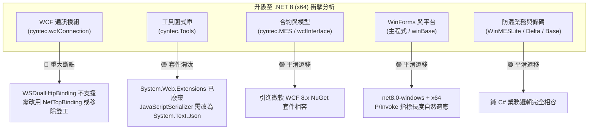
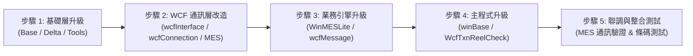

# cyntec.WcfTxnReelCheck 升級至 .NET 8 (x64) 模組影響度全面評估報告

---

## 1. 評估背景與目標

* **現行規格**：.NET Framework 4.6.1、平台目標 x86（32位元）、Windows Forms。
* **預計升級目標**：**.NET 8 (LTS)**、平台架構 **x64（64位元）**。
* **評估範圍**：主執行專案 [`cyntec.WcfTxnReelCheck`](file:///D:/SourceCode/CS/cyntec.WcfTxnReelCheck/cyntec.WcfTxnReelCheck.csproj) 以及位於 `dll/` 下所引用的全部 9 個核心組件。

---

## 2. 核心架構挑戰與重大相容性斷點 (Breaking Changes)

在全面檢視程式碼後，升級至 .NET 8 (x64) 的主要技術瓶頸聚焦於兩點：**WCF 雙工通訊** 與 **過時的 Web 序列化元件**。

### 2.1 🔴 最關鍵斷點：`cyntec.wcfConnection` 的 `WSDualHttpBinding` 不受 .NET 8 支援
* **問題根源**：現行 [`wcfServiceConnection.cs`](file:///D:/SourceCode/CS/cyntec.WcfTxnReelCheck/dll/cyntec.wcfConnection/cyntec.WCF/wcfServiceConnection.cs#L274-L284) 在 HTTP 模式下使用的是 `WSDualHttpBinding`（需在客戶端電腦本地開啟 HTTP Listener 接收 Server 回呼，例如 `http://127.0.0.1:8080/APP_01`）。
* **微軟規範限制**：微軟官方的 .NET Core / .NET 8 WCF Client 函式庫（`System.ServiceModel.*`）**完全不支援 `WSDualHttpBinding`**，因其依賴本機 HTTP 伺服器且規範已被現代通訊協定淘汰。
* **因應對策（三選一）**：
  1. **方案 A（推薦，若 Server 支援）**：改走 `NetTcpBinding`（如 `net.tcp://...`）。.NET 8 的 `System.ServiceModel.NetTcp` 搭配 `System.ServiceModel.Duplex` **完全支援** 雙工通訊。
  2. **方案 B（最簡化）**：檢視本系統業務，[`frmReelCheck.cs`](file:///D:/SourceCode/CS/cyntec.WcfTxnReelCheck/frmReelCheck.cs) 實際上未訂閱 Server 廣播回呼，純粹執行 Request-Reply。可將連線改為標準的 `WSHttpBinding` 或 `BasicHttpBinding`，移除雙工 Callback 依賴。
  3. **方案 C**：Server 端全面改為 RESTful WebAPI / gRPC。

### 2.2 🟡 次要斷點：`cyntec.Tools` 中的 `System.Web.Extensions` 淘汰
* **問題根源**：[`cyntecJsonDictionary.cs`](file:///D:/SourceCode/CS/cyntec.WcfTxnReelCheck/dll/cyntec.Tools/cyntec.Tools/cyntecJsonDictionary.cs#L2) 引用了舊時代 ASP.NET 的 `System.Web.Script.Serialization.JavaScriptSerializer`。
* **因應對策**：.NET 8 已不再提供此命名空間。直接改用 .NET 8 內建高效能的 `System.Text.Json.JsonSerializer` 或現有引用的 `Newtonsoft.Json`。

### 2.3 🟢 x64 平台相容性評估：100% 通過
* **P/Invoke 呼叫檢核**：程式碼中僅有 [`Windows.cs`](file:///D:/SourceCode/CS/cyntec.WcfTxnReelCheck/dll/cyntec.Tools/cyntec.Tools/Windows.cs#L12-L22) 與 [`frmMsgBox.cs`](file:///D:/SourceCode/CS/cyntec.WcfTxnReelCheck/dll/cyntec.winBase/cyntec.Windows/frmMsgBox.cs#L109-L110) 呼叫 Windows 系統 API（`user32.dll` 與 `kernel32.dll` 的 `Beep`, `GetSystemMenu`, `DeleteMenu`, `GetConsoleWindow`），均使用 `IntPtr` 作為 Handle，在 x64 環境下指標長度會自然從 4 bytes 提升至 8 bytes，完全無溢位或相容性問題。
* **無第三方 32-bit Native DLL**：專案中無任何 C/C++ 編譯的 32 位元專屬二進位檔，切換至 x64 不會拋出 `BadImageFormatException`。

---

## 3. 各 DLL 需修改項目與影響度詳細矩陣

| 序號 | 組件名稱 | 影響度 | 專案檔 (csproj) 修改 | 程式碼 / NuGet 修改項目 |
| :---: | :--- | :---: | :--- | :--- |
| **1** | **`cyntec.wcfConnection`** | 🔴 **高** | 改為 SDK 格式： `<TargetFramework>net8.0</TargetFramework>` `<PlatformTarget>x64</PlatformTarget>` | 1. 移除 GAC `System.ServiceModel` 2. 引入 NuGet 套件 `System.ServiceModel.Primitives`, `System.ServiceModel.Http`, `System.ServiceModel.NetTcp`, `System.ServiceModel.Duplex` 3. 重構 `m_ReConnection()`：移除 `WSDualHttpBinding`，改為 `NetTcpBinding` 或 `WSHttpBinding` |
| **2** | **`cyntec.Tools`** | 🟡 **中** | 改為 SDK 格式： `<TargetFramework>net8.0</TargetFramework>` `<PlatformTarget>x64</PlatformTarget>` | 1. 移除 `System.Web.Extensions` 2. 修改 [`cyntecJsonDictionary.cs`](file:///D:/SourceCode/CS/cyntec.WcfTxnReelCheck/dll/cyntec.Tools/cyntec.Tools/cyntecJsonDictionary.cs)，改用 `System.Text.Json` 3. 更新 `DotNetZip` 至 .NET Standard/8 相容版本，或改用 `System.IO.Compression` |
| **3** | **`cyntec.MES`** | 🟡 **中** | 改為 SDK 格式： `<TargetFramework>net8.0</TargetFramework>` `<PlatformTarget>x64</PlatformTarget>` | 1. 移除舊版 GAC `System.ServiceModel` 與 `System.Runtime.Serialization` 2. 引入 NuGet 套件 `System.ServiceModel.Primitives` 3. 業務資料合約（DataContract）完全相容 |
| **4** | **`cyntec.wcfInterface`** | 🟢 **低** | 改為 SDK 格式： `<TargetFramework>net8.0</TargetFramework>` `<PlatformTarget>x64</PlatformTarget>` | 引入 NuGet 套件 `System.ServiceModel.Primitives`，介面宣告無需改動 |
| **5** | **`cyntec.WcfTxnReelCheck`** (主程式 WinExe) | 🟢 **低** | 升級為新式 SDK 格式： `<TargetFramework>net8.0-windows</TargetFramework>` `<UseWindowsForms>true</UseWindowsForms>` `<PlatformTarget>x64</PlatformTarget>` | 1. 移除 `bin\dll` 二進位引用，改為 `ProjectReference` 2. 移除未使用的 `System.Windows.Forms.DataVisualization` 引用 3. 檢查組態檔複製指令相容性 |
| **6** | **`cyntec.WinMESLite`** | 🟢 **低** | 改為 SDK 格式： `<TargetFramework>net8.0</TargetFramework>` `<PlatformTarget>x64</PlatformTarget>` | 核心防混驗證（[`ReelBarcodeCheck`](file:///D:/SourceCode/CS/cyntec.WcfTxnReelCheck/dll/cyntec.WinMESLite/cyntec.WinMES.ReelCheck/ReelBarcodeCheck.cs)）邏輯 100% 相容，改為專案相依即可 |
| **7** | **`cyntec.winBase`** | 🟢 **低** | 改為 SDK 格式： `<TargetFramework>net8.0-windows</TargetFramework>` `<UseWindowsForms>true</UseWindowsForms>` `<PlatformTarget>x64</PlatformTarget>` | WinForms 對話框與 UI 樣式完全相容 |
| **8** | **`cyntec.wcfMessage`** | 🟢 **低** | 改為 SDK 格式： `<TargetFramework>net8.0</TargetFramework>` `<PlatformTarget>x64</PlatformTarget>` | 改為專案相依，程式碼無需修改 |
| **9** | **`cyntec.Delta`** | 🟢 **低** | 改為 SDK 格式： `<TargetFramework>net8.0</TargetFramework>` `<PlatformTarget>x64</PlatformTarget>` | 純字串與 2D 條碼解析（[`Barcode2D88`](file:///D:/SourceCode/CS/cyntec.WcfTxnReelCheck/dll/cyntec.Delta/cyntec.Delta/Barcode2D88.cs)），100% 相容 |
| **10**| **`cyntec.Base`** | 🟢 **低** | 改為 SDK 格式： `<TargetFramework>net8.0</TargetFramework>` `<PlatformTarget>x64</PlatformTarget>` | 自訂執行緒模型與語系完全相容 |

---

## 4. 具體遷移實施路徑建議 (Step-by-Step Migration Plan)

### 第一階段：基礎層平移
1. 升級 `cyntec.Base` 與 `cyntec.Delta` 為 .NET 8 x64。
2. 升級 `cyntec.Tools`：將 `cyntecJsonDictionary` 的序列化改寫為 `System.Text.Json`。

### 第二階段：通訊層核心改造（關鍵瓶頸攻堅）
1. 確定後端 MES WCF 服務端點是否支援 `net.tcp://`。
   * 若支援：`cyntec.wcfConnection` 改採 `NetTcpBinding`。
   * 若僅支援 HTTP：評估將 `wcfServiceConnection` 改造為單向 `WSHttpBinding` 或 `BasicHttpBinding`。
2. 升級 `cyntec.wcfInterface` 與 `cyntec.MES`，引入 `System.ServiceModel.Primitives` 套件。

### 第三階段：業務層與主介面整合
1. 將 `cyntec.WinMESLite`、`cyntec.winBase` 升級為 .NET 8。
2. 將主專案 `cyntec.WcfTxnReelCheck` 升級為 .NET 8 WinForms x64，並將所有依賴改為 Visual Studio 專案相依（Project Reference），實現一次性編譯建置。
