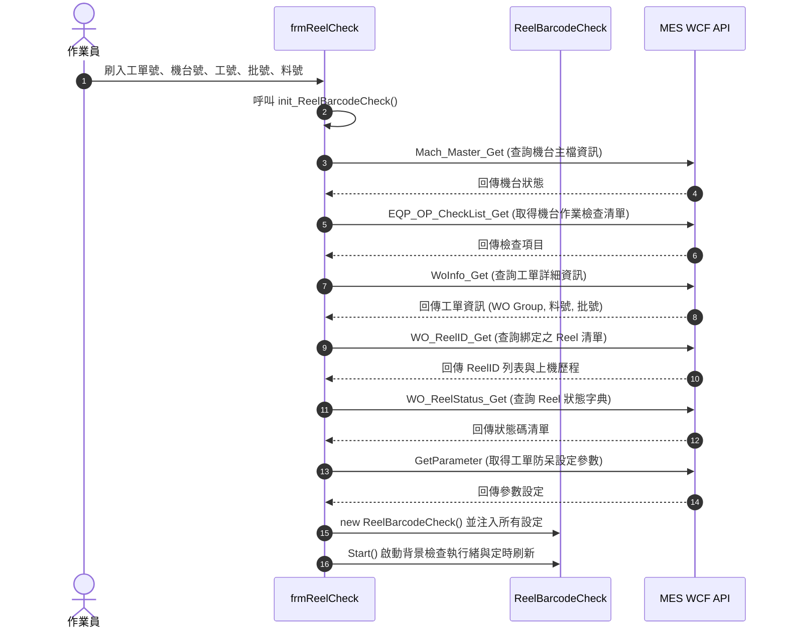

# cyntec.WcfTxnReelCheck 專案架構與業務邏輯深度分析報告

---

## 1. 專案概述 (Executive Summary)

[`cyntec.WcfTxnReelCheck`](file:///D:/SourceCode/CS/cyntec.WcfTxnReelCheck/cyntec.WcfTxnReelCheck.csproj) 是乾坤科技（Cyntec / 達達集團 Delta Group）應用於被動元件/半導體製造現場的 **Reel（料捲/捲帶）標籤防混防錯檢驗系統**。

本系統主要部署於生產機台端的作業員電腦或工控機，透過串接條碼掃描槍（RS-232 / 鍵盤仿真），在作業員進行上料、更換料捲或工單生產時，即時比對條碼資訊與製造執行系統（MES）的工單與機台狀態，防止**混料、上錯機台、跨工單混用、重複上機、未過帳作業**等重大品質異常事件。

```mermaid
flowchart TD
    subgraph Client ["產線端客戶端 (cyntec.WcfTxnReelCheck)"]
        UI["使用者介面 (frmReelCheck)"]
        Scanner["條碼掃描槍 (RS-232 / Barcode)"]
        CoreEngine["防混檢驗核心 (ReelBarcodeCheck)"]
        LocalConfig["本地組態 (cyntec.ReelCheck.xml)"]
        LogEngine["日誌引擎 (cyntecLog / WOLog)"]
    end

    subgraph Backend ["後端製造執行系統 (MES)"]
        WCFEntrance["WCF 服務端點 (Wcf.svc)"]
        DB[(MES 資料庫 / WO_REELID / WorkOrder)]
    end

    Scanner -->|掃描條碼| CoreEngine
    CoreEngine -->|狀態反饋與清單更新| UI
    LocalConfig -->|讀取連線與日誌參數| CoreEngine
    CoreEngine -->|寫入運作日誌| LogEngine
    CoreEngine <==>|WCF API (Mach / WO / Reel / Param)| WCFEntrance
    WCFEntrance <==> DB
```

---

## 2. 專案技術規格與相依結構 (Technical Architecture)

### 2.1 開發環境與框架設定
* **目標框架**：.NET Framework 4.6.1（x86 平台目標）
* **應用程式類型**：Windows Forms 桌面應用程式（WinExe）
* **版本號碼**：`2026.3.6.1`（定義於 [AssemblyInfo.cs](file:///D:/SourceCode/CS/cyntec.WcfTxnReelCheck/Properties/AssemblyInfo.cs#L35-L36)）
* **進入點**：[Program.cs](file:///D:/SourceCode/CS/cyntec.WcfTxnReelCheck/Program.cs#L31-L43)（包含全域未捕捉例外之彈窗與日誌紀錄）

### 2.2 模組相依性與架構層次
本專案依賴於 Cyntec 內部標準函式庫家族，其模組關係如下：

| 組件名稱 | 職責與用途 | 原始碼位置 |
| :--- | :--- | :--- |
| **`cyntec.WcfTxnReelCheck`** | UI 展現層、工單輸入、事件驅動、生命週期管理 | [`/`](file:///D:/SourceCode/CS/cyntec.WcfTxnReelCheck) |
| **`cyntec.WinMESLite`** | 核心防混驗證邏輯（[`ReelBarcodeCheck`](file:///D:/SourceCode/CS/cyntec.WcfTxnReelCheck/dll/cyntec.WinMESLite/cyntec.WinMES.ReelCheck/ReelBarcodeCheck.cs)）、Reel 記錄與狀態機 | [`dll/cyntec.WinMESLite/`](file:///D:/SourceCode/CS/cyntec.WcfTxnReelCheck/dll/cyntec.WinMESLite) |
| **`cyntec.MES`** | MES 資料傳輸物件（DTO）與 WCF 交易命令定義（`WoInfo_Get`, `WO_ReelID_Get` 等） | [`dll/cyntec.MES/`](file:///D:/SourceCode/CS/cyntec.WcfTxnReelCheck/dll/cyntec.MES) |
| **`cyntec.Delta`** | Delta/Cyntec 專屬 2D 條碼解析規格（[`Barcode2D88`](file:///D:/SourceCode/CS/cyntec.WcfTxnReelCheck/dll/cyntec.Delta/cyntec.Delta/Barcode2D88.cs)） | [`dll/cyntec.Delta/`](file:///D:/SourceCode/CS/cyntec.WcfTxnReelCheck/dll/cyntec.Delta) |
| **`cyntec.wcfConnection`** | WCF 通訊連線封裝、逾時處理、容錯移轉（Failover）支援 | [`dll/cyntec.wcfConnection/`](file:///D:/SourceCode/CS/cyntec.WcfTxnReelCheck/dll/cyntec.wcfConnection) |
| **`cyntec.wcfInterface`** | WCF 服務介面契約（Service Contract） | [`dll/cyntec.wcfInterface/`](file:///D:/SourceCode/CS/cyntec.WcfTxnReelCheck/dll/cyntec.wcfInterface) |
| **`cyntec.wcfMessage`** | WCF 序列化與訊息傳輸封裝 | [`dll/cyntec.wcfMessage/`](file:///D:/SourceCode/CS/cyntec.WcfTxnReelCheck/dll/cyntec.wcfMessage) |
| **`cyntec.Tools`** | 日誌寫入器（`cyntecLog`）、檔案處理工具（`cyntecFile`） | [`dll/cyntec.Tools/`](file:///D:/SourceCode/CS/cyntec.WcfTxnReelCheck/dll/cyntec.Tools) |
| **`cyntec.Base`** | 多語系（`cyntecCulture`）、自訂執行緒（`cyntecThread`）、日期時間格式化 | [`dll/cyntec.Base/`](file:///D:/SourceCode/CS/cyntec.WcfTxnReelCheck/dll/cyntec.Base) |
| **`cyntec.winBase`** | WinForms 視窗共用基底控制項與介面樣式 | [`dll/cyntec.winBase/`](file:///D:/SourceCode/CS/cyntec.WcfTxnReelCheck/dll/cyntec.winBase) |

> [!NOTE]
> 主專案目前引用的是位於 `bin\dll\` 的二進位 DLL 檔案，但其所有底層函式庫原始碼均完整保存於 `dll/` 目錄中（以反編譯還原方式建置專案結構）。

---

## 3. 核心業務流程分析 (Core Business Workflows)

### 3.1 系統初始化與組態載入
程式啟動後由 [`frmReelCheck.cs:init_LogWCF()`](file:///D:/SourceCode/CS/cyntec.WcfTxnReelCheck/frmReelCheck.cs#L56-L112) 載入 [`XML/cyntec.ReelCheck.xml`](file:///D:/SourceCode/CS/cyntec.WcfTxnReelCheck/XML/cyntec.ReelCheck.xml)：
1. **多語系配置**：預設設定為繁體中文（`cyntecCulture.Language = cyntecCulture.zh_TW`）。
2. **日誌管理**：啟用 DEBUG/INFO/ERROR 等級，支援自動記錄過期清除（保留 30 天，大小上限 5MB）。
3. **WCF 通訊初始化**：
   * 主要伺服端端點：`http://twcynmeswebqa01/WcfEntranceTest/WCF/Wcf.svc`
   * 備用伺服端列表：支援容錯移轉清單（`SERVER_URL_LIST`）
   * 客戶端識別碼：`ReelCheck @ {本機電腦名稱}`

### 3.2 工單查詢與防混物件初始化流程
當作業員在 UI 刷入工單號碼並點擊「[#2 標籤程式初始化(工單查詢)](file:///D:/SourceCode/CS/cyntec.WcfTxnReelCheck/frmReelCheck.cs#L386-L407)」時，觸發 [`init_ReelBarcodeCheck()`](file:///D:/SourceCode/CS/cyntec.WcfTxnReelCheck/frmReelCheck.cs#L128-L246)，依序呼叫 6 項 MES WCF API：



### 3.3 條碼防呆檢驗與解析流程
當作業員透過掃描槍掃入條碼或手動測試時，進入 [`ReelBarcodeCheck.cs`](file:///D:/SourceCode/CS/cyntec.WcfTxnReelCheck/dll/cyntec.WinMESLite/cyntec.WinMES.ReelCheck/ReelBarcodeCheck.cs) 之佇列與檢驗流程：

```mermaid
flowchart TD
    Scan([收到條碼字串]) --> CheckSwitch{防混檢查開關<br/>是否開啟?}
    CheckSwitch -- 否 --> Ignore[忽略此條碼並記錄日誌]
    CheckSwitch -- 是 --> CheckZE01{是否為工程工單<br/>ZE01?}
    CheckZE01 -- 是 --> Ignore
    CheckZE01 -- 否 --> Sanitize[條碼字串格式前置清洗與修復]
    
    Sanitize --> FmtCheck{條碼格式基本檢核}
    FmtCheck -- 純數字/長度小於9/含特殊符號 --> FilterOut[判定無效條碼並略過]
    FmtCheck -- 合法條碼 --> Parse2D[以 '{' 解析 Barcode2D88 結構]
    
    Parse2D --> DecodeReel[f_ReelIDDecode: 字元代換解密還原 ReelID]
    DecodeReel --> RulesCheck{比對防混規則}
    
    RulesCheck -- 違反任一防呆規則 --> NG[標籤檢查異常 NG<br/>顯示紅色警告, 記錄錯誤, 觸發停機鎖機]
    RulesCheck -- 完全符合所有條件 --> OK[標籤檢查正常 OK<br/>顯示綠色正常, 更新 Reel 掃描次數與狀態]
```

---

## 4. 防混異常檢驗規則清單 (Poka-Yoke Rules)

系統中實作的防混防錯規則極為嚴謹，記錄於 [`標籤防混錯誤訊息清單.txt`](file:///D:/SourceCode/CS/cyntec.WcfTxnReelCheck/標籤防混錯誤訊息清單.txt) 與核心程式中，主要涵蓋以下六大類別：

### 4.1 條碼格式與硬體防呆 (NG-98xx / NG-99xx)
* **NG-9801**：條碼槍硬體異常（掃描內容包含 `ERROR`）。
* **NG-9802 / NG-9803**：條碼內容包含 `:`、`%` 或 `?` 時，程式會嘗試自動拆解與修復。
* **NG-9901 ~ NG-9906**：防呆過濾純數字、長度不足（`< 9`）、料號與 T/P No 混接黏合條碼。

### 4.2 主料與副料防混 (NG-0101 ~ NG-0104)
* **NG-0101 / NG-0103**：當前製程為「主料」，但掃入副料號或副料 T/P No. 條碼。
* **NG-0102 / NG-0104**：當前製程為「副料」，但掃入主料號或主料 T/P No. 條碼。

### 4.3 工單歸屬防混 (NG-0105 ~ NG-0107, NG-0401)
* **NG-0105**：掃入的 T/P No. 屬於另一張工單。
* **NG-0106**：掃入的料號條碼屬於其他未知工單。
* **NG-0401 / NG-0401B**：當前工單作業中發現其他工單或問題工單的 Reel。

### 4.4 機台綁定與重複上機防錯 (NG-0108 ~ NG-0110)
* **NG-0108**：Reel 預期狀態應為 `11`，但已被手動更動。
* **NG-0109**：Reel 預期作業機台為 A，但被攜至機台 B 掃描。
* **NG-0110**：Reel ID 已經重複上機台（避免重複投入生產）。

### 4.5 工單與資料庫狀態異動防護 (NG-0201 ~ NG-0203, NG-0301 ~ NG-0305)
* **NG-0201**：工單可能在後端被刪除 Confirm。
* **NG-0202**：工單已被過帳（`ConfirmDate` 與最初刷入工單時不一致）。
* **NG-0203**：工單出站狀態改變（已出站後不可繼續投料）。
* **NG-0301 ~ NG-0305**：`WO_REELID` 資料表狀態異動、料號不一致或 T/P No 不一致。

### 4.6 生產作業時間與掃描次數驗證 (NG-0111 ~ NG-0113)
* **NG-0111 / NG-0112**：大標籤（料號條碼 / T/P No. 條碼）掃描次數小於系統要求之最低次數。
* **NG-0113**：Reel 作業時間小於設定之最小作業時間（防止人員未經實際生產快速過站）。

---

## 5. 核心演算法與設計亮點

### 5.1 專屬字元置換式 Reel ID 加解密
為了防止人員自行偽造條碼或肉眼辨識，系統在 [`ReelBarcodeCheck.cs:f_ReelIDDecode`](file:///D:/SourceCode/CS/cyntec.WcfTxnReelCheck/dll/cyntec.WinMESLite/cyntec.WinMES.ReelCheck/ReelBarcodeCheck.cs#L385-L417) 採用雙向對映置換：
```csharp
private const string strDESAPHA    = "-0123456789ABCDEFGHIJKLMNOPQRSTUVWXYZ";
private const string strSOURCEAPHA = "-QXERPWS89AKCMNT56OF2HIYBLDV4U37GZ01J";
```
透過將明文字元與密文字元進行 1:1 索引置換，達成產線 2D 條碼防偽與校驗。

### 5.2 容錯移轉與彈性 WCF 連線管理
[`wcfServiceConnection`](file:///D:/SourceCode/CS/cyntec.WcfTxnReelCheck/dll/cyntec.wcfConnection) 具備主從備援機制，當主要的 MES 應用程式伺服器無回應時，能自動依序嘗試 `SERVER_URL_LIST` 中的備用伺服器，確保產線不會因為單一伺服器故障而停擺。

---

## 6. 程式碼品質分析、潛在風險與改善建議

### 6.1 發現之潛在問題與技術債

> [!WARNING]
> **1. 方案專案結構與組件相依管理不一致**
> * 現況：主方案 [`cyntec.WcfTxnReelCheck.sln`](file:///D:/SourceCode/CS/cyntec.WcfTxnReelCheck/cyntec.WcfTxnReelCheck.sln) 僅包含單一 WinForms 專案，引用的函式庫為 `bin\dll\` 的二進位實體檔。
> * 風險：雖然 `dll/` 下已有完整的原始碼，但兩者未連結為 Solution 內部的 Project Reference，若日後修改了 `dll/cyntec.WinMESLite` 的程式碼，無法直接聯調與自動更新輸出，容易造成版本不一致。

> [!CAUTION]
> **2. 專案尚未納入 Git 版本控制**
> * 現況：檢測工作目錄發現並無 `.git` 目錄。
> * 風險：缺乏歷史修訂紀錄、分支管理與自動化備份機制，任何程式碼改動均暴露在不可逆的覆蓋風險中。

> [!IMPORTANT]
> **3. UI 執行緒同步與鎖定模式**
> * 現況：在 [`f_ShowReelInfo()`](file:///D:/SourceCode/CS/cyntec.WcfTxnReelCheck/frmReelCheck.cs#L320) 中使用了 `lock (dataGridView1)`，且頻繁透過 `this.Invoke` 更新畫面。
> * 風險：`lock` UI 控制項物件並非常見的最佳實踐，容易在複雜背景事件頻繁觸發時導致 UI 介面微卡頓（Jank）或死鎖（Deadlock）。建議使用獨立的 `private readonly object _syncRoot = new object();` 進行資料集合鎖定，再透過非同步或批次更新 UI。

> [!NOTE]
> **4. 例外處理吞噬**
> * 現況：在視窗關閉 [`frmReelCheck_FormClosing`](file:///D:/SourceCode/CS/cyntec.WcfTxnReelCheck/frmReelCheck.cs#L524) 等處存在空的 `catch { }` 區塊。
> * 建議：即使是關閉時的例外，也應呼叫 `m_Log.LogDebug/LogError` 記錄，便於排查產線異常崩潰或執行緒未完全釋放的問題。

---

## 7. 總結與後續建議行動方案

本專案是針對半導體/被動元件高精密生產設計的關鍵品質守門員系統，其業務防呆邏輯（Poka-Yoke）覆蓋全面、考慮周詳。

建議後續優化步驟如下：
1. **立即建立 Git 版本控制**：建立 `.gitignore`（忽略 `bin/`, `obj/`, `*.user` 等）並進行初始 Commit。
2. **重構 Visual Studio 方案**：將 `dll/` 下各核心子專案納入 `cyntec.WcfTxnReelCheck.sln`，並將二進位引用改為專案相依（Project Reference）。
3. **加強單元測試覆蓋**：針對 [`Barcode2D88`](file:///D:/SourceCode/CS/cyntec.WcfTxnReelCheck/dll/cyntec.Delta/cyntec.Delta/Barcode2D88.cs) 解析邏輯與 `f_ReelIDDecode` 加解密演算法建立單元測試，確保後續擴充規格時的向後相容性。
