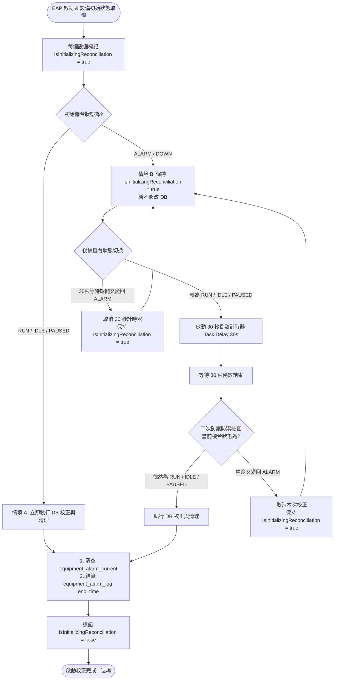

# 🛡️ EAP 啟動孤立警報校正 (Orphan Alarm Reconciliation) 流程圖

本文件說明 EAP Dashboard 啟動時對每個設備執行的孤立警報校正機制（避免因斷線或重啟期間遺漏 Alarm Clear 事件導致 Local DB 殘留歷史警報）。

---

## 📊 完整校正流程圖 (Mermaid Flowchart)

---

## ⚙️ 核心邏輯與二階段防護說明

### 1. 旗標機制 (Initialization Flag)
* 每個設備實例皆維護一旗標 `IsInitializingReconciliation`（預設為 `true`）。
* 此校正流程**在 EAP 啟動後僅會對每個設備執行一次**。一旦執行完畢並修改 DB，旗標即轉為 `false` (Turn OFF)，後續日常運作不再重複觸發。

### 2. 情境 A：啟動時機台為 RUN / IDLE / PAUSED (非警報狀態)
* **行為**：直接呼叫 `ReconcileOrphanAlarmsLocalDbAsync()`。
* **DB 動作**：
  1. `DELETE FROM equipment_alarm_current WHERE equipment_no = @EqpId;`
  2. `UPDATE equipment_alarm_log SET end_time = UTC_NOW WHERE equipment_no = @EqpId AND end_time IS NULL;`
* **結果**：將 `IsInitializingReconciliation` 設為 `false`。

### 3. 情境 B：啟動時機台為 ALARM / DOWN (警報中)
* **行為**：保持旗標為 `true` 暫不變更 DB。
* **觸發時機**：當機台警報解除，狀態切換為 **RUN**、**IDLE** 或 **PAUSED** 時：
  * **啟動 30 秒計時器**：等待機台正常的 Alarm End 事件處理完畢。
  * **二次防禦檢查 (Double-Check)**：30 秒倒數結束時，若機台狀態依然為 RUN、IDLE 或 PAUSED，則執行 DB 清理並將旗標設為 `false`；若 30 秒內機台又跳回 ALARM，則取消本次清理並重置計時器。

---

## 📝 Log 紀錄範例

* **情境 A (即時清理)**：
  `[Reconciliation] Equipment ZZ0304 initial state is Running. Executing immediate DB alarm reconciliation.`
  `[Reconciliation] Equipment ZZ0304 orphan DB alarms reconciled & cleared. IsInitializingReconciliation set to FALSE.`

* **情境 B (延遲 30 秒清理)**：
  `[Reconciliation] Equipment ZZ0304 initial state is Alarm. Pending 30s reconciliation upon status change.`
  `[Reconciliation] Equipment ZZ0304 changed state to Running. Started 30s timer for orphan DB alarm reconciliation.`
  `[Reconciliation] Equipment ZZ0304 orphan DB alarms reconciled & cleared. IsInitializingReconciliation set to FALSE.`
