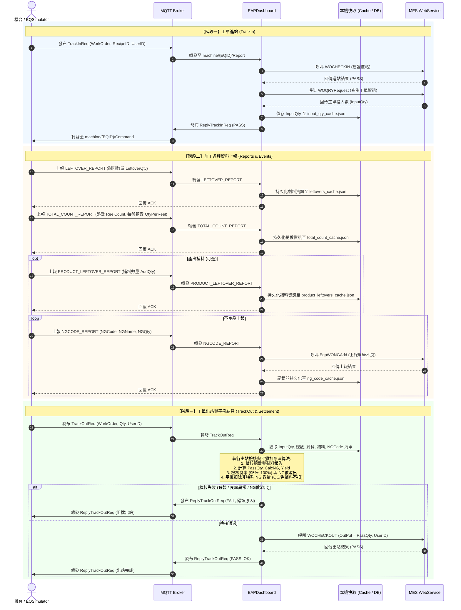
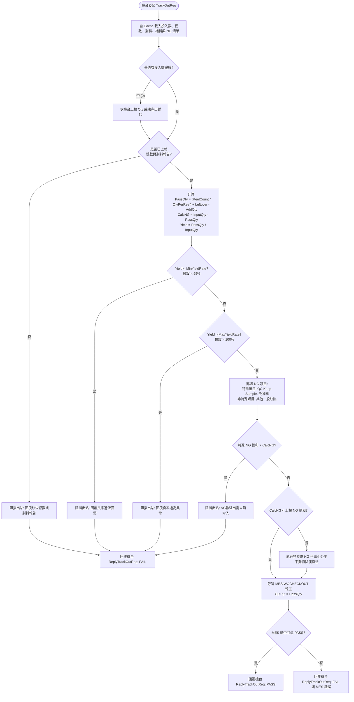
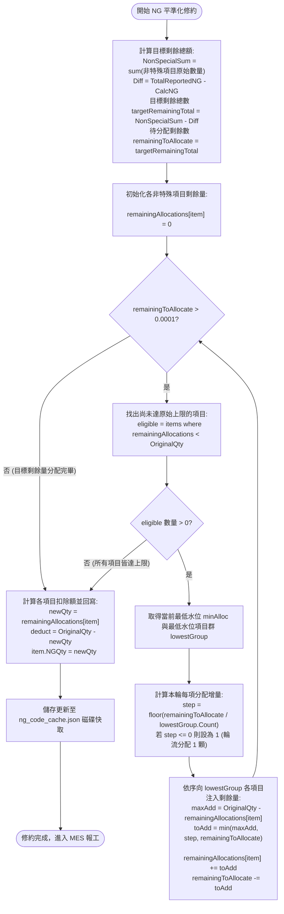

# 📋 TP 設備出站計算與良率檢核測試計畫 (TP Calculation & Yield Test Plan)

本文件詳細定義 EAPDashboard 針對 TP 系列（Taping & Packaging / 包裝編帶）設備之出站計算、良率檢核、NG 代碼平攤扣除演算法、完整通訊時序流程以及測試情境矩陣。

---

## ▍ 1. 核心業務通訊生命週期流程圖 (End-to-End Sequence)

---

## ▍ 2. 核心計算公式與架構設計

### 2.1 良品數與 NG 數計算公式
$$\text{PassQty} = (\text{ReelCount} \times \text{QtyPerReel}) + \text{LeftoverQty} - \text{ProductLeftoverAddQty}$$
$$\text{CalcNG} = \text{InputQty} - \text{PassQty}$$
$$\text{Yield} = \frac{\text{PassQty}}{\text{InputQty}} \times 100\%$$

* **參數定義**：
  * **$\text{InputQty}$ (投入數)**：進站時透過 MES `WOQRYRequest` 查詢取得之工單投入數（儲存於快取 `input_qty_cache.json`）。
  * **$\text{ReelCount}$ (盤數)**：機台透過總數上報事件（`TOTAL_COUNT_REPORT`）上報之已編帶盤數。
  * **$\text{QtyPerReel}$ (每盤顆數)**：機台透過總數上報事件上報之標準單盤數量。
  * **$\text{LeftoverQty}$ (剩料數)**：機台透過剩料上報事件（`LEFTOVER_REPORT`）上報之當批尾數剩料。
  * **$\text{ProductLeftoverAddQty}$ (產出補料數)**：機台透過產出補料事件（`PRODUCT_LEFTOVER_REPORT`）上報之補料數（預設為 0）。
  * **$\text{PassQty}$ (計算良品數)**：出站時由 EAP 自動計算得出，並自動覆寫報工給 MES `WOCHECKOUT` 的 `torQty`。
  * **$\text{CalcNG}$ (計算不良品數)**：出站時由投入數減去良品數得出，作為 MES 報工之不良總數。

---

## ▍ 3. 出站檢核與判定決策流程圖 (Validation Decision Flow)

---

## ▍ 4. 非特殊 NG 剩餘量平準化演算法流程圖 (Water-Level Remaining Balance Allocation)

---

## ▍ 5. 測試情境矩陣 (Test Scenarios Matrix)

| 編號 | 測試情境 | 投入數 (Input) | 上報參數 (總數/剩料/補料) | 上報 NG 清單 (Reported NG) | 預期計算 PassQty / NG | 預期結果與行為 |
| :---: | :--- | :---: | :--- | :--- | :---: | :--- |
| **TC-01** | **正常出站 (剩餘量平準化修約)** | 1000 | 盤數: 9, 單盤: 100 (900) 剩料: 90, 補料: 10 | QC Keep Sample: 5 免補料: 5 UPNG501 (Card): 20 UPNG502 (Broken): 10 | $\text{PassQty} = 980$ $\text{CalcNG} = 20$ $\text{Yield} = 98.0\%$ | **PASS 出站成功** Diff = 20，目標剩餘 = 10。 特殊項目不扣 (各5)。 UPNG501 扣 15 ($\rightarrow 5$)，UPNG502 扣 5 ($\rightarrow 5$)。 兩者剩餘數量皆平準為 5 顆。 MES OutPut = 980。 |
| **TC-02** | **缺報總數或剩料** | 1000 | 未發送總數或剩料上報 | DEF1: 10 | 無法計算 | **FAIL 阻擋出站** 回覆 `Missing TotalCountReport / LeftoversReport`。 |
| **TC-03** | **良率過低異常 (<95%)** | 1000 | 盤數: 8, 單盤: 100 (800) 剩料: 0, 補料: 0 | DEF1: 200 | $\text{PassQty} = 800$ $\text{CalcNG} = 200$ $\text{Yield} = 80.0\%$ | **FAIL 阻擋出站** 回覆 `Yield rate (80.0%) below minimum limit (95.0%)`。 |
| **TC-04** | **良率過高異常 (>100%)** | 1000 | 盤數: 11, 單盤: 100 (1100) 剩料: 0, 補料: 0 | 無 | $\text{PassQty} = 1100$ $\text{CalcNG} = -100$ $\text{Yield} = 110.0\%$ | **FAIL 阻擋出站** 回覆 `Yield rate (110.0%) above maximum limit (100.0%)`。 |
| **TC-05** | **特殊 NG 數溢出** | 1000 | 盤數: 9, 單盤: 100 (900) 剩料: 80, 補料: 0 | QC Keep Sample: 25 免補料: 0 | $\text{PassQty} = 980$ $\text{CalcNG} = 20$ | **FAIL 阻擋出站** SpecialNGSum (25) > CalcNG (20)，回覆 `NG數溢出，需要人員介入處理`。 |
| **TC-06** | **多項目含小額缺陷平準化** | 1000 | 盤數: 9, 單盤: 100 (900) 剩料: 93, 補料: 10 | QC Keep Sample: 5 SMALL: 2 BIG1: 20 BIG2: 10 | $\text{PassQty} = 983$ $\text{CalcNG} = 17$ | **PASS 出站成功** Diff = 20，目標剩餘 = 12。 QC 不扣 (5)。 SMALL 保留上限 2 (扣 0)，BIG1 扣 15 ($\rightarrow 5$)，BIG2 扣 5 ($\rightarrow 5$)。 MES OutPut = 983。 |
| **TC-07** | **重啟持久化快取驗證** | 1000 | 上報總數、剩料、NG 代碼 | 各類 NG | 相同 PassQty | **PASS 驗證通過** EAP 重啟後讀取 `Cache/*.json` 快取，各項數據不遺失並順利完成出站。 |

---

## ▍ 6. EQ 模擬器操作驗證步驟 (Simulator Guide)

### 步驟 1：啟動 EAPDashboard 與 EQSimulator
1. 執行 `EAPDashboard.exe`，確認 MQTT Broker 狀態指示燈為綠色 Connected。
2. 啟動 `EQSimulator.exe`，設定機台 ID（如 `TP0013`）與 Broker 資訊，點擊 **「連線」**。

### 步驟 2：執行情境測試（以情境 1 為例）
1. 在 EQ 模擬器下方 **「TP 測試情境」** 下拉選單中選擇 `Scenario 1: 正常出站 (投入1000 / 良品980 / 良率98%)`。
2. 點擊 **「載入情境參數」**（此時機台 ID 與 MQTT 連線參數保持不變，業務參數自動填入）。
3. 依序點擊下方操作按鈕：
   * 點擊 **`TrackIn`** ➜ MES 進站成功。
   * 點擊 **`剩料上報`** ➜ 記錄尾數 80 顆。
   * 點擊 **`總數上報`** ➜ 記錄 9 盤 $\times$ 100 顆 = 900 顆。
   * 點擊 **`上報全部 NG`** ➜ 上報 4 筆缺陷項目。
   * 點擊 **`TrackOut`** ➜ EAP 執行平攤計算並覆寫 `torQty = 980`，MES 出站成功。
4. 觀察 EAP 儀表板與日誌視窗，確認出站良品數、扣減明細與 MES 回應完全相符。
